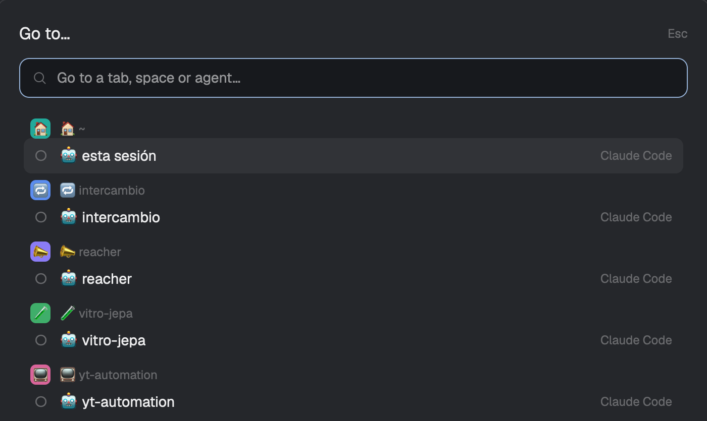

# quick-switcher

A Raycast-style switcher for [Herdr](https://herdr.dev): jump to any tab, space or agent from one popup, even with dozens of agents running on several machines.



- Spaces with an agent working, blocked or done come first, blocked on top; quiet spaces fold into "earlier".
- Type to filter by space, tab or agent name. ↑/↓ and Enter to go, ctrl+d closes the selected tab, Esc leaves.
- The last rows start new work: a tab here, a space on this computer or on each connected machine.

It is a clone of Herdr's own `picker`, rebuilt for long lists. A Herdr script render is cut off after about 50 ms; with 25 spaces, 45 tabs and 42 agents the shipped picker took up to 92 ms per render and showed "This view could not be re-rendered; interrupted". This one draws rows with `v_virtual_list`, so a render costs the same however many tabs you have.

## Install

```sh
git clone https://github.com/frizynn/quick-switcher
cp -R quick-switcher/mods/quick-switcher ~/.config/herdr-app/mods/
```

Then add the key from this repo's `keys.json` to your `~/.config/herdr-app/keys.json` (`"cmd-shift-k": "mod.open:quick-switcher"` in `global`; pick another key if you use that one). Or ask your agent to add this mod: Herdr's `AGENTS.md` tells it how.

Runs `hc machine ls` to list connected machines. Reads no files and makes no network requests.

`herdr-app check` (0.1.9) crashes on any mod with a virtual list, Herdr's own `changes` included, so verify this one in the running app.

`RECIPE.md` is the brief to rebuild it from scratch.
