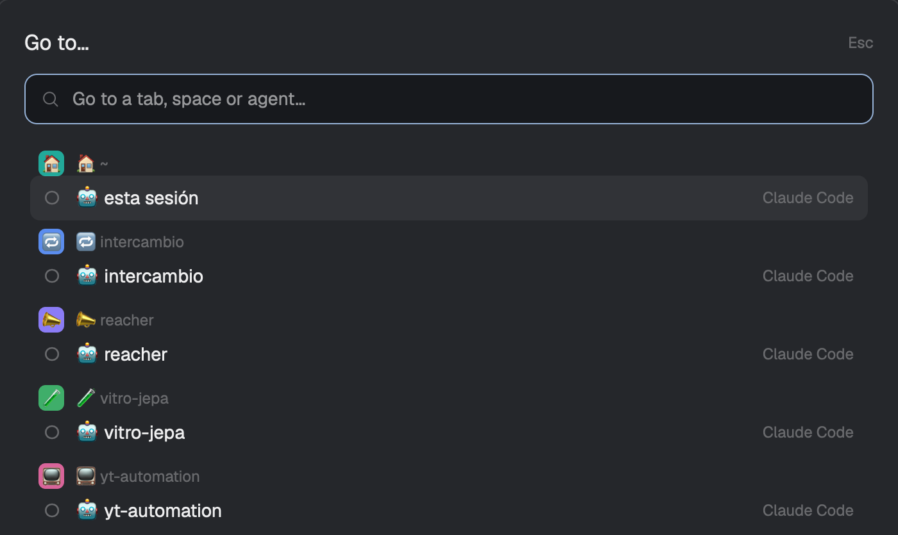

# quick-switcher

A "go to" popup for spaces, tabs and agents that stays responsive with dozens of agents on several machines. 

**What you see:** a popup 640 px wide, 40 px from the top, on `popover`, 18px padding: "Go to…" (15px semibold) with "Esc" at the right; a 36px search field with an `accent` border and the search icon; then a list up to 320px tall. Each space with something going on gets a 29px head: an 18px rounded tile in the space's color with its first letter in white, and the name in 11px semibold `dim`. Under it a 32px row per tab: a status glyph (a spinning ring `working`, ● `blocked`/`done`, ○ `idle`, · none), the tab name (semibold for the current one), "needs you" in `blocked` or "finished" in `done`, and at the right the agents' program names with "+N" sub-agents. Then "earlier: N quiet spaces ▾", and rows "+ new tab", "+ new space", "+ new space on <machine>". The selected row is `hover`.

**How it behaves:** it opens on the current tab. Typing filters by space, tab or program name and shows quiet spaces too. ↑/↓ move through tabs and new rows (wrapping), Enter or a click goes there (`tab.select`, `tab.new`, `space.new {machine}`), ctrl+d closes the selected tab, Esc closes. Clicking "earlier" folds or unfolds quiet spaces. Blocked spaces sort first.

**Built from:** a clone of Herdr's `picker` (`mod.json` with `overlay: {kind: "popup", at: "top", offset: 40, width: 640, height: 0.8}` and `cloned_from`), bound in `keys.json` as `mod.open:quick-switcher` on `cmd-shift-k`. Rows come from `spaces()`, `agents()`, `terminals()` (sub-agents by `parent`) through `model.js`, and are drawn by `v_virtual_list` with per-row heights (head 29, tab 32, earlier 35, new 36, space 32); clicks go through `on_item_click` with the row key. Space colors live in shared `space.colors` (theme names `ansi1..6` mapped to fixed hexes, or a picked `#rrggbb`). Connected machines from `hc machine ls --json`. Icons from `mods/workspace-chrome/`.

**Watch out:** a script render is cut off between 50 and 60 ms. Building every row costs up to ~90 ms at 45 tabs, so the list must be virtual; Herdr's data calls are cheap (0.1–0.25 ms) and caching them does nothing. Handlers can't be registered inside a virtual list's row renderer. Don't `setShared` from `render`: it re-renders every mod. `herdr-app check` 0.1.9 panics on virtual lists, so verify in the app.

**Done when:** with 40+ agents, Cmd+Shift+K opens, scrolls and filters without "interrupted"; Enter on a tab goes there; ctrl+d closes the selected tab.
